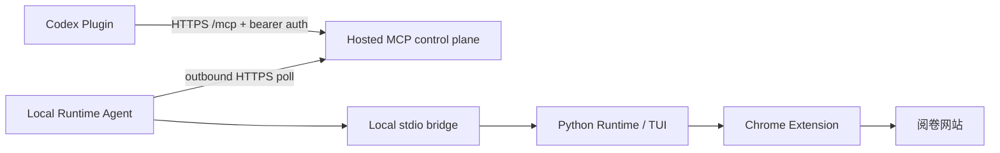

# MCP 部署与本地 Runtime 配对

仓库现在包含两种 MCP 连接形态：

| 形态 | 文件 | 适用场景 |
| --- | --- | --- |
| 本地 stdio bridge | `plugins/suhuang-scroll/mcp/server.mjs` + `.mcp.json` | Codex Desktop/CLI、本地开发、无公网服务的单机使用 |
| Hosted control plane | `services/mcp-control-plane/src/server.mjs` | 公开 Plugin 提交所需的 HTTPS MCP URL |

两种形态使用同一组工具名。Hosted control plane 只负责 MCP 连接和短期命令
转发；本地 Agent 仍调用现有 stdio bridge，Python Runtime、模型请求、浏览器
Cookie、Chrome Extension 和成绩数据都留在用户机器上。



## 部署 control plane

服务只依赖 Node.js 20+，可以直接启动：

```bash
export SUHUANG_MCP_TOKEN="$(openssl rand -hex 32)"
export SUHUANG_AGENT_TOKEN="$(openssl rand -hex 32)"
npm start --prefix services/mcp-control-plane
```

生产环境把服务放在 HTTPS 反向代理或托管平台之后，公开 MCP 地址为：

```text
https://<your-host>/mcp
```

健康检查地址是 `/healthz`。控制平面默认使用单实例内存队列，重启会丢弃尚未
完成的命令。多用户或多实例部署前，需要加入持久化队列、用户级授权、限流和
租户隔离；当前 bearer token map 可以用于审核 demo 或单租户部署：

```bash
export SUHUANG_MCP_TOKENS_JSON='{"mcp-token":"demo"}'
export SUHUANG_AGENT_TOKENS_JSON='{"agent-token":"demo"}'
```

服务不会把 token、命令参数或工具结果写入日志。它仍会在处理请求期间暂存在
内存中，因此公开部署前应把隐私政策和保留期限写成与实际配置一致的内容。

Hosted endpoint 按 Streamable HTTP 接收 `POST /mcp`。当前实现支持现代
`2026-07-28` 的无握手、按请求 metadata 模式，也兼容
`2025-11-25`、`2025-06-18`、`2025-03-26` 和 `2024-11-05` 的 initialize 握手。
现代请求必须在 body 的 `_meta` 中提供 protocol version、clientInfo 和
clientCapabilities，并在 HTTP 头中提供匹配的 `MCP-Protocol-Version`、`Mcp-Method`
和（工具调用时）`Mcp-Name`；`Accept` 必须同时包含 `application/json` 与
`text/event-stream`。`server/discover` 可用于获取支持的版本和能力。当前 relay
不使用服务器推送，因而 `GET /mcp` 返回 `405`，客户端应使用 POST 发送 JSON-RPC。

如果 MCP 客户端运行在浏览器上下文中，应配置精确的 Origin allowlist：

```bash
export SUHUANG_ALLOWED_ORIGINS="https://<the-browser-origin-used-by-your-deployment>"
```

多个 Origin 可用空格或逗号分隔。带有 Origin 的请求必须精确命中 allowlist；不带
Origin 的服务端请求不受这项跨域检查影响，但仍必须通过 MCP bearer/OAuth 认证。

如果接入外部 OAuth 2.1 身份服务，设置 `SUHUANG_MCP_RESOURCE` 与
`SUHUANG_OAUTH_ISSUER` 后，服务会提供
`/.well-known/oauth-protected-resource` 和带 `resource_metadata` 的 401 challenge。
生产环境还应设置 `SUHUANG_RESOURCE_DOCUMENTATION`，指向公开站点上的 MCP
部署说明；服务不会假设 control plane 自己托管仓库 Markdown 文件。
再设置 `SUHUANG_OAUTH_JWKS_URL` 与 `SUHUANG_OAUTH_AUDIENCE` 后，服务会校验
RS256 access token 的 issuer、audience、scope、过期时间和 JWKS 签名，并把
`SUHUANG_OAUTH_TENANT_CLAIM`（默认 `tenant_id`，缺失时回退 `sub`）映射到
tenant。静态 token map 继续用于本地/审核 demo；授权服务器的 discovery、PKCE、
scope 和撤销策略仍应纳入部署测试。

Hosted relay 的每个工具都会声明 `oauth2` 与 `suhuang:runtime` scope。生产环境
应让授权服务器提供 OAuth 2.1 discovery、PKCE（S256）和 token audience/resource
绑定；只配置 JWKS 校验而没有一个完整授权服务器时，不能直接作为公开 Plugin
提交环境。

Hosted relay 的工具 metadata 还会提供面向用户的 `title`。工具统一使用
`readOnlyHint=false`，原因是每次调用都会在 control plane 中创建一个短期队列项；
诊断和准备工具使用 `destructiveHint=false`，两个 live control 使用
`destructiveHint=true`，并且额外要求 `confirm=true`。所有工具的
`openWorldHint=false`；启动始终是 `manual_confirm`，提交只转发当前待确认的浏览器
决策，不接受任意分数 payload。提交门户的 Scan Tools 会读取这些 annotation，不能只
靠 worksheet 中的文字覆盖服务器实际返回的值。

### 给官方审核的合成 tenant

官方 Scan Tools 或人工审核没有义务安装本地 Runtime。部署一个独立的审核 token 时，
可以开启合成 fixture，让审核者在不接触私人 workspace 的情况下调用正向工具：

```bash
export SUHUANG_MCP_REVIEW_MODE="fixture"
export SUHUANG_MCP_REVIEW_TENANTS="codex-review"
export SUHUANG_MCP_TOKENS_JSON='{"<review-token>":"codex-review"}'
```

这个模式只匹配列出的 tenant，返回公开的 `workspace/specs/minimal-fill-blank-spec.md`
元数据、结构化诊断、空统计和 `prepare_only` 结果。它不读取文件，不启动本地 Agent，
不调用视觉模型，不生成真实 pairing code，也不包含学生/OCR 内容。普通 OAuth tenant
仍使用配对的本地 Runtime；审核 token 应单独限时、限 scope，并且不得与真实用户复用。
未设置 `SUHUANG_MCP_REVIEW_MODE=fixture` 时，fixture 路径关闭。部署后查看 `/healthz`
的 `reviewMode`，确认审核环境和生产环境没有误混。

部署前可以用不提交到 Git 的生产环境文件做配置形状检查：

```bash
python scripts/release/check_mcp_deployment_config.py \
  --env-file /path/to/mcp-production.env
```

它要求 OAuth issuer/JWKS/audience、resource、scope 和精确 Origin 配置；静态
MCP token 只允许出现在显式隔离的 `fixture` tenant 配置中。配置形状通过后，仍需
在公网地址上运行 `check_public_endpoints.py`，因为 discovery 和 JWKS 签名只能在
真实部署环境中验证。

## 运行本地 Agent

用户安装 Runtime 后，先在 Codex 中调用 `suhuang_runtime_pair`，再把返回的
一次性 pairing code 交给本机 Agent：

```bash
SUHUANG_CONTROL_PLANE_URL="https://<your-host>" \
SUHUANG_PAIRING_CODE="<one-time-code>" \
SUHUANG_ROOT="/path/to/agentic-grading" \
node plugins/suhuang-scroll/mcp/agent.mjs
```

Agent 会向 `/v1/runtime/pair` 换取短期 Agent token，再开始轮询。已有部署也可
直接设置 `SUHUANG_AGENT_TOKEN`，适合服务管理器和单租户环境。

Agent 不监听端口。远程调用的 `root`、`specPath`、`runDir` 默认只能是相对于
`SUHUANG_ROOT` 的路径；`suhuang_get_stats` 通过 hosted relay 不开放逐条学生
或 OCR 记录。Agent 会移除结果中的本机绝对路径，再把结果返回 control plane。

本地开发可以临时使用 HTTP，但生产环境必须使用 HTTPS：

```bash
SUHUANG_ALLOW_INSECURE_HTTP=1 \
SUHUANG_CONTROL_PLANE_URL="http://127.0.0.1:8080" \
SUHUANG_AGENT_TOKEN="agent-token" \
SUHUANG_ROOT="/path/to/agentic-grading" \
node plugins/suhuang-scroll/mcp/agent.mjs
```

## Plugin 与提交入口

Plugin 包中的 `.mcp.json` 保留本地 stdio bridge，方便 Codex Desktop/CLI 和贡献
者测试。公开提交时，在 OpenAI Plugin submission portal 的 MCP 页面填写真实的
`https://<your-host>/mcp`，不要把 `localhost` 或占位 URL 当成生产端点。

公开 Plugin 提交直接在 Platform submission portal 中填写生产环境的 Hosted MCP
URL，然后执行 Scan Tools。开发者模式中注册的 MCP 连接 ID 只用于本地测试；如果
拿到了真实的 `plugin_asdk_app...`（或平台返回的其他连接 ID），可以额外生成带
`.app.json` 的兼容候选包。脚本不会修改工作树中的本地插件清单：

```bash
python scripts/release/package_codex_plugin.py \
  --channel public \
  --public-base-url "$SUHUANG_PUBLIC_BASE_URL" \
  --release-repo "$SUHUANG_RELEASE_REPO" \
  --output dist/release/SuhuangScroll-CodexPlugin-public-v0.1.0.zip
```

若要同时生成开发者模式兼容 wiring，再追加
`--app-id "$SUHUANG_PLUGIN_APP_ID" --app-key suhuang-scroll`；这个 ID 不参与公开
提交门户的 Hosted MCP URL 配置。

如果使用 `--app-id`，它必须来自真实的开发者连接页面；脚本会拒绝 URL、占位符
和明显的示例 ID。`--public-base-url` 会把 Plugin 的网站、隐私和条款链接统一
指向公开站点的 `/`、`/privacy`、`/terms` 路径；它不能是 localhost 或 `.local`
开发地址。没有这个 ID 时，公共归档仍然保留本地 `.mcp.json` bridge；公开 Hosted
MCP 连接由提交门户中的 `serverURL` 配置负责。带 `.app.json` 的归档只用于开发者
模式兼容测试。

提交门户要求的 listing、OAuth/MCP、starter prompts、5 个正向测试、3 个负向测试、
可用地区和归档 SHA256 可以由同一组真实部署参数生成：

```bash
python scripts/release/package_codex_submission.py \
  --public-base-url "$SUHUANG_PUBLIC_BASE_URL" \
  --mcp-url "$SUHUANG_MCP_URL" \
  --release-repo "$SUHUANG_RELEASE_REPO" \
  --countries CN \
  --package-archive dist/release/SuhuangScroll-CodexPlugin-public-v0.1.0.zip \
  --output dist/release/SuhuangScroll-CodexPlugin-submission-v0.1.0.json
```

`--countries` 必须由发布者根据实际服务范围填写，脚本不会替发布者猜测地区。
生成的 JSON 是提交 worksheet，不会自动创建或提交商店 draft。

仓库还提供 `.github/workflows/public-store-candidates.yml`。在 GitHub Actions
中手动触发时填写公网站点 origin、Hosted MCP URL 和可用地区；开发者模式 App ID
为可选项，流水线
会一次生成带 URL 改写的 Codex Plugin、Codex submission worksheet、Chrome Web
Store 包、listing worksheet 和 Hosted MCP 部署包；它不会自动提交商店或改变仓库
可见性。

如果提交门户要求域名校验，把 token 配置为：

```bash
export SUHUANG_OPENAI_APPS_CHALLENGE="<portal-issued-token>"
```

服务会让 `GET /.well-known/openai-apps-challenge` 原样返回该 token。隐私、支持、
条款 URL 必须能从公网访问，并且发布者身份、网站和这些政策页面要一致。

## 验证与打包

```bash
npm test --prefix services/mcp-control-plane
python scripts/release/check_plugin_package.py
python scripts/release/check_codex_plugin_archive.py \
  dist/release/SuhuangScroll-CodexPlugin-public-v0.1.0.zip \
  --public-base-url "$SUHUANG_PUBLIC_BASE_URL" \
  --release-repo "$SUHUANG_RELEASE_REPO"
python scripts/release/package_codex_submission.py \
  --public-base-url "$SUHUANG_PUBLIC_BASE_URL" \
  --mcp-url "$SUHUANG_MCP_URL" \
  --release-repo "$SUHUANG_RELEASE_REPO" \
  --countries CN
python scripts/release/package_mcp_control_plane.py
```

部署到公网后，用真实站点地址做一次只读 preflight。没有审核 token 时，脚本会
验证五个公开页面、MCP `/healthz`、protected-resource metadata、OAuth
authorization-server discovery、PKCE S256、token endpoint authentication 和 MCP
返回的 OAuth 401 challenge；设置 `SUHUANG_MCP_REVIEW_TOKEN` 后还会验证
authenticated `initialize`：

```bash
python scripts/release/check_public_endpoints.py \
  --site-url "$SUHUANG_PUBLIC_BASE_URL" \
  --mcp-url "$SUHUANG_MCP_URL"
```

启用了审核 fixture tenant 时，可以把短期审核 token 放在环境变量中，再额外执行两个
无副作用工具调用：

```bash
export SUHUANG_MCP_REVIEW_TOKEN="<short-lived-review-token>"
python scripts/release/check_public_endpoints.py \
  --site-url "$SUHUANG_PUBLIC_BASE_URL" \
  --mcp-url "$SUHUANG_MCP_URL" \
  --check-review-fixture
```

当前服务公开诊断、列举、校验、统计摘要、`prepare_grading`，以及两个需要
`confirm=true` 的 live controls：`suhuang_start_grading` 和
`suhuang_control_grading`。启动始终使用 `manual_confirm`；`submit` 只确认当前
等待中的浏览器决策，不接受任意分数 payload，也不存在自动提交模式。合成
review tenant 会返回 `gradingStarted: false`，不会启动 Runtime 或调用模型。
