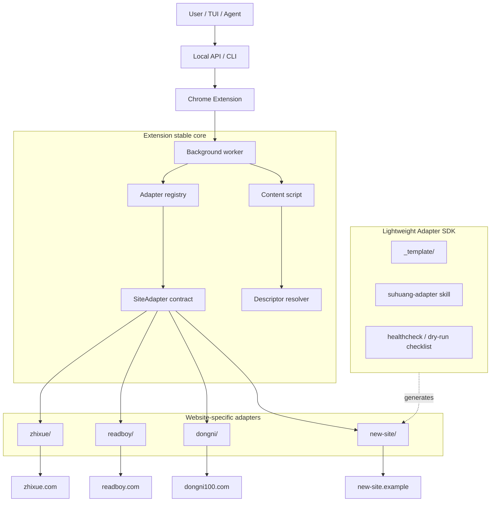

# Site Adapter SDK

本文档定义 Suhuang Scroll 的轻量 Site Adapter SDK。这里的 SDK 不是动态远程插件系统，而是给人和 AI Agent 编写新阅卷网站适配器时使用的源码级模板、接口契约和验证流程。

## 目标

- 保持现有 CLI、TUI、本地 API 和 Chrome Extension 工作流不变。
- 把现有 `SiteGradingAdapter` 接口整理成稳定的 adapter contract。
- 给每个新网站提供可复制的 adapter 目录模板。
- 让 adapter skill 可以按同一套规则生成、注册、验证新网站适配器。
- 默认只做 healthcheck、capture 和 dry-run，不自动启用真实提交。

## 关系图



## Stable Core vs Website Code

Stable core files should not need new website selectors or website-specific submit logic:

- `extension/src/adapters/core/site-adapter.ts`
- `extension/src/adapters/core/registry.ts`
- `extension/src/adapters/core/descriptor.ts`
- `extension/src/adapter/contracts.ts`
- `extension/src/background/index.ts`

Website-specific files belong under one adapter directory:

```text
extension/src/adapters/<site-id>/
  index.ts
  capture.ts
  page-context.ts
  descriptors.ts
```

If a site needs unusual submission behavior, add narrowly scoped helpers under the same directory, for example `dom-submitter.ts` or `network-submitter.ts`.

## Adapter Contract

Every concrete website adapter implements `SiteGradingAdapter` from `extension/src/adapters/core/site-adapter.ts`.

Required public surface:

- `id`: stable adapter id, matching the manifest id.
- `displayName`: operator-facing site name.
- `capabilities`: what this adapter supports.
- `match(url)`: whether this adapter owns the current tab URL.
- `getPageContext(tabId)`: read site, paper index, question id, and page metadata.
- `captureCurrentAnswer(tabId, selector?)`: capture the current answer image or canvas.
- `writeScore(tabId, request)`: write a score without necessarily submitting.
- `submitScore(tabId, request)`: submit one score.
- `submitBatchScores(tabId, request)`: submit blank-level scores when supported.
- `observePageChange(tabId, timeoutMs?)`: detect navigation to the next answer.
- `healthcheck(tabId)`: probe required targets and report failures.

The adapter may return unsupported results for operations it does not safely support. A capture-only adapter is valid.

## Descriptor-First Rule

Prefer descriptors before custom DOM code. Descriptors make it easier for AI Agents to generate and review adapters because targets are explicit:

- `answerImage`
- `scoreInput`
- `submitButton`
- `batchScoreInputs`
- `nextItemSignal`
- `questionLabel`

Use custom TypeScript only when descriptors cannot express the site behavior.

## Files to Create for a New Site

Copy `extension/src/adapters/_template/` to `extension/src/adapters/<site-id>/`, then convert the `.tmpl` files into `.ts` files.

Recommended first milestone:

1. Implement `match`.
2. Implement `capture.ts` with answer image descriptors.
3. Implement `page-context.ts`.
4. Implement `descriptors.ts` for healthcheck probes.
5. Keep write and submit unsupported unless explicitly requested.
6. Add a conservative entry to `core/python/resources/site_adapters.json`.
7. Register the adapter in `extension/src/adapters/index.ts`.
8. Add host permissions to `extension/manifest.json`.

## Registration Points

New adapter code is not dynamically loaded from the network. It is source code compiled into the extension.

For a new adapter `<site-id>`:

- Add `extension/src/adapters/<site-id>/`.
- Add import and `registerAdapter(...)` call in `extension/src/adapters/index.ts`.
- Add host permissions and content-script matches in `extension/manifest.json`.
- Add adapter metadata to `core/python/resources/site_adapters.json`.
- If current content-script routing needs a site-specific branch, keep that branch narrow and move selectors/helpers into the adapter directory.

## Manifest Defaults

New adapters must start conservative:

```json
{
  "status": "registered",
  "autoSubmitEnabled": false,
  "capabilities": {
    "singleScore": false,
    "batchScores": false,
    "domSubmit": false,
    "networkSubmit": false,
    "observeNext": true,
    "healthcheck": true
  }
}
```

Move toward `validated` only after healthcheck and dry-run pass. Move to `enabled` and `autoSubmitEnabled: true` only with explicit production approval.

## Safe Validation

Use this sequence for a newly generated adapter:

```bash
python core/python/cli.py adapters list
python core/python/cli.py adapters inspect <site-id>
cd extension
npm run build
```

Then load the rebuilt extension in Chrome and test on a representative grading page:

1. Run healthcheck.
2. Confirm `answerImage` succeeds.
3. Confirm `pageContext` identifies the site.
4. Confirm `scoreInput` and `submitButton` only if write/submit is in scope.
5. Run dry-run write/submit only.
6. Do not run real submission without explicit user confirmation.

## Skill Workflow

The `suhuang-adapter` skill should use this SDK as its source of truth:

1. Read this document.
2. Copy the adapter template.
3. Fill descriptors and page context from observed DOM.
4. Register the adapter conservatively.
5. Run static checks.
6. Guide browser healthcheck and dry-run.
7. Leave auto-submit disabled unless the user explicitly asks to enable it after validation.

